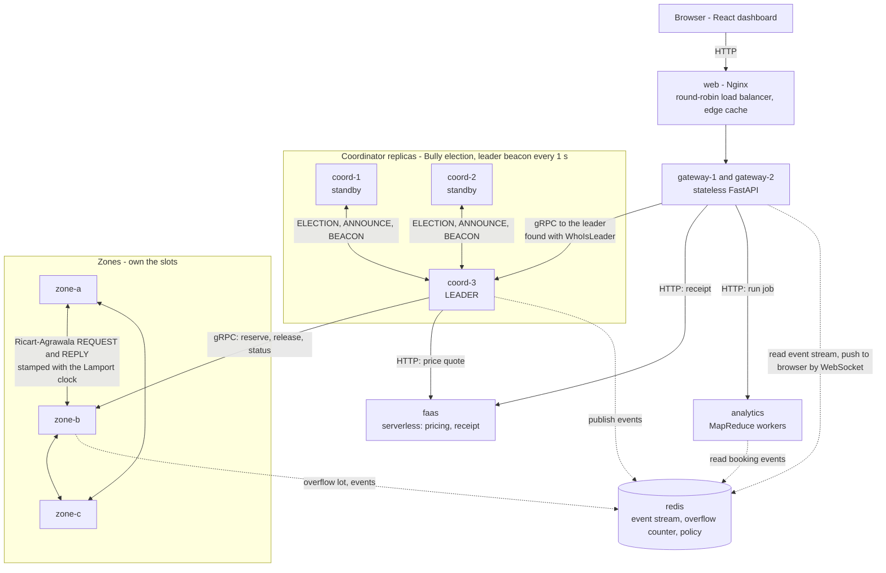
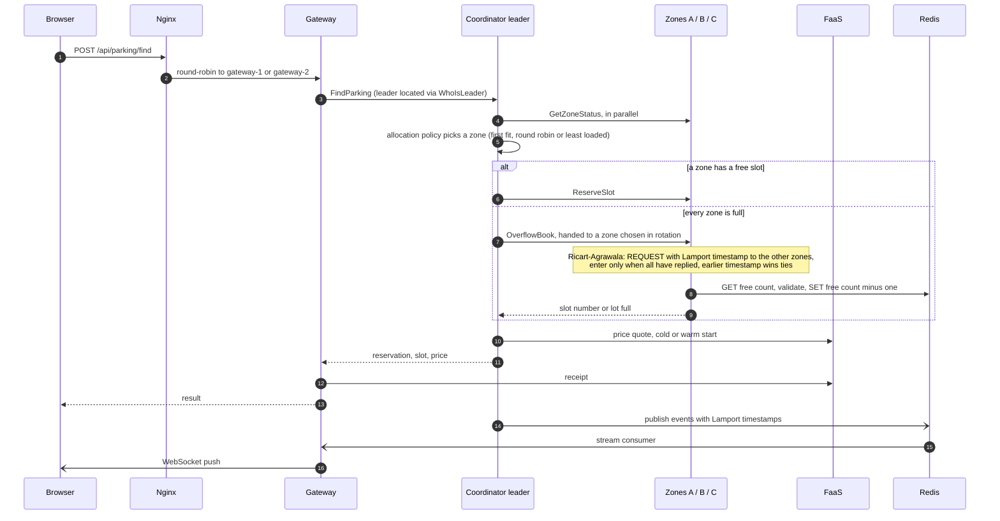

# FA-2 Architecture

## 1. What problem is this, as a *distributed* system?

A campus parking system whose parts run on different nodes that can fail independently and share **no clock and no memory**. The interesting engineering is not "send a message between two programs" (that is networking) but what must be solved *because* there are several nodes:

| Distributed-systems problem | Where it shows up here | Solved by |
|---|---|---|
| Single point of failure | One coordinator served everything in FA-1 | 3 replicas + Bully election + beacon |
| Concurrent access to a shared resource | When every zone is full, any of the three zones can admit cars to one shared overflow lot | Ricart-Agrawala mutual exclusion |
| No global clock to order competing requests | Ricart-Agrawala must decide which zone's request came first | Lamport clock |
| Load concentration | First-fit hammered Zone A | Load-aware allocation + request load balancing |
| Node crash / recovery | Zone or coordinator dies | Heartbeats, re-registration, leader rediscovery |

## 2. Component view

How to read it:

* **Control path (solid, top to bottom):** browser → Nginx → one of two gateways → the *current* coordinator leader → zones. Gateways and zones find the leader by asking any replica `WhoIsLeader`, so a failover needs no reconfiguration.
* **Zone ↔ zone traffic:** only the Ricart-Agrawala messages that guard the shared overflow lot (plus the FA-1 P2P capacity polling). Each message carries a Lamport timestamp.
* **Redis plays three roles:** event stream (relayed to the browser over WebSocket), the shared overflow counter, and the allocation-policy setting.

### Booking flow, including the overflow lot

## 3. Server inventory and configuration

*"How many servers do you have, and what are their configurations?"* — Under Docker Compose there are **12 containers**, each with its own hostname (= its own network identity) and enforced CPU/memory limits. `docker compose ps` and `docker stats` show them live; the dashboard's **Cloud → Deployment** table shows the same data.

| Container | Count | Role | CPU limit | Memory limit | Address inside the network |
|---|---|---|---|---|---|
| web | 1 | Nginx load balancer, edge cache, UI | 0.50 | 128 MB | web:80 → host 8080 |
| gateway-1, gateway-2 | 2 | Stateless API gateway | 0.50 each | 256 MB each | gateway-N:8000 |
| coord-1, coord-2, coord-3 | 3 | Coordinator replicas (1 leader, 2 standbys) | 0.50 each | 256 MB each | coord-N:510N |
| zone-a, zone-b, zone-c | 3 | Slot service, overflow-lot mutex | 0.25 each | 128 MB each | zone-x:500x (P2P 600x) |
| redis | 1 | Event streams + shared config | 0.50 | 128 MB | redis:6379 |
| faas | 1 | Serverless runtime | 0.25 | 128 MB | faas:9000 |
| analytics | 1 | MapReduce workers | 1.00 | 512 MB | analytics:9100 |

Total = 5.5 vCPU limit / 2.5 GB limit (limits, not reservations). Ports differ only because the same code also runs as plain local processes on one machine; in containers each node additionally has a distinct hostname/IP. On Kubernetes the same layout becomes pods (`k8s/`).

> Be precise in the viva: this is one *physical* host running 12 isolated containers (virtualization). The nodes are genuinely separate processes with separate network stacks and separate failure domains, but they share the host's hardware. A multi-host run needs Docker Swarm/Kubernetes across machines — the manifests support that, we simply have not run it on more than one machine.

## 4. Key design decisions

1. **One elected leader, standbys on hot standby (active–passive).** Only the leader serves parking requests, so allocation decisions are serialised without distributed locking. The price: throughput is bounded by one coordinator; the benefit is simplicity and a short failover (≈ beacon timeout 4 s + election ≈ 0.5 s).
2. **The leader keeps no irreplaceable state.** Zones own slot state; reservation IDs encode their zone. A new leader rebuilds its registry by probing the zones (`_become_leader_setup`).
3. **Terms.** Every leadership has a monotonically increasing term (as in Raft). Beacons carry it; a leader that receives a higher term steps down. A restarted node first *asks peers for their term* before declaring itself leader (otherwise a freshly restarted high-id node would announce a stale term and be ignored).
4. **Clocks live in the middleware, not the application.** `ClientClockInterceptor`/`ServerClockInterceptor` attach and merge the Lamport clock on every gRPC call (request metadata out, trailing metadata back). Application code just calls `stub.Method()`, and every event it publishes is stamped.
5. **Algorithms are separated from transport.** `distributed/*.py` take injected send functions, so they are unit-tested against an in-memory network (`tests/unit/test_algorithms.py`) and wired to gRPC in the services. This is what makes the algorithms demonstrably correct rather than only demonstrably running.
6. **Mutual exclusion over a deliberately weak shared resource.** The overflow lot is a Redis counter updated with plain `GET` then `SET` (not `DECR`), so correctness comes from the algorithm and not from a lucky atomic primitive. A crashed peer is treated as an implicit grant (fault-tolerant variant). The leader hands each overflow booking to a zone in rotation (like a car arriving at that zone's gate), so different zones really do compete for the lot; a zone runs one Ricart-Agrawala request at a time and queues its own concurrent ones behind a local lock.
7. **Only the synchronisation the system needs.** One clock (Lamport), because Ricart-Agrawala needs a total order of requests. No physical clock sync (nothing compares wall-clock times across nodes), no vector clocks (nothing must detect concurrent updates), no global snapshot (no feature needs a consistent global view).

## 5. What is *not* implemented (be upfront)

* No multi-host cluster run; Kubernetes manifests are validated structurally but were not applied to a live cluster in development.
* Zones keep slot state in memory (no durable storage); a restarted zone loses it (it does re-join and re-register).
* Lodha–Kshemkalyani and distributed deadlock detection are self-study notes, not code.
* The "FaaS platform" and "MapReduce engine" are small local models of Lambda/Hadoop, not those products.
